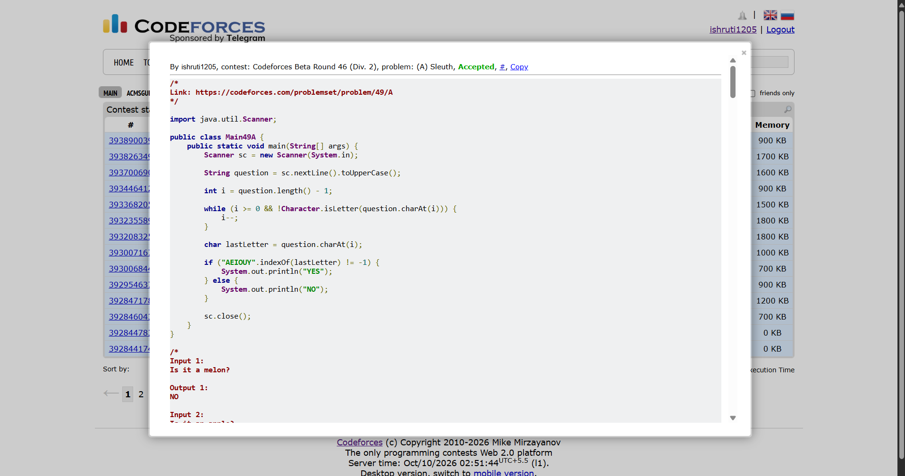

## Date: 10 October 2026 (Day 10)  
**Name:** Shruti  
**Programming Language:** Java 

## Problem
[A. Sleuth](https://codeforces.com/problemset/problem/49/A)

## Approach
I convert the input question to uppercase and scan backward to find the last letter, ignoring spaces and punctuation. Then, I check whether the letter belongs to AEIOUY. If it does, I print YES; otherwise, I print NO.

## Code

```java
import java.util.Scanner;

public class Main50A {
    public static void main(String[] args) {
        Scanner sc = new Scanner(System.in);

        int m = sc.nextInt();
        int n = sc.nextInt();

        System.out.println((m * n) / 2);

        sc.close();
    }
}

/*
Input 1:
2 4

Output 1:
4

Input 2:
3 3

Output 2:
4
*/
```

## Accepted Solution Screenshot

