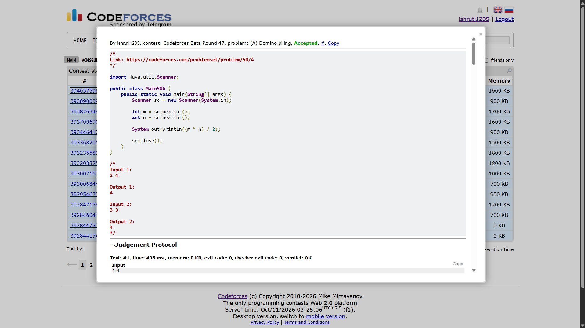

## Date: 11 October 2026 (Day 11)  
**Name:** Shruti  
**Programming Language:** Java 

## Problem
[A. Domino piling](https://codeforces.com/problemset/problem/50/A)

## Approach
I calculate the total number of squares on the m×n board and divide it by 2, since each domino covers exactly two squares. The integer division gives the maximum number of dominoes that can be placed.

## Code

```java
import java.util.Scanner;

public class Main50A {
    public static void main(String[] args) {
        Scanner sc = new Scanner(System.in);

        int m = sc.nextInt();
        int n = sc.nextInt();

        System.out.println((m * n) / 2);

        sc.close();
    }
}

/*
Input 1:
2 4

Output 1:
4

Input 2:
3 3

Output 2:
4
*/
```

## Accepted Solution Screenshot

