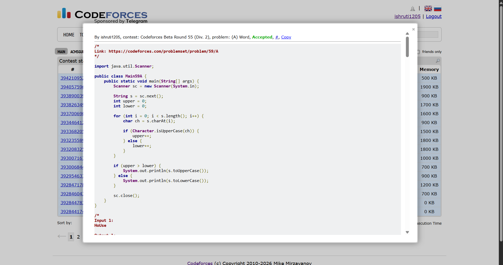

## Date: 12 October 2026 (Day 12)  
**Name:** Shruti  
**Programming Language:** Java 

## Problem
[A. Word](https://codeforces.com/problemset/problem/59/A)

## Approach
I count the uppercase and lowercase letters in the string. If uppercase letters are more numerous, I convert the entire string to uppercase; otherwise, I convert it to lowercase. If both counts are equal, I choose lowercase.

## Code

```java
import java.util.Scanner;

public class Main59A {
    public static void main(String[] args) {
        Scanner sc = new Scanner(System.in);

        String s = sc.next();
        int upper = 0;
        int lower = 0;

        for (int i = 0; i < s.length(); i++) {
            char ch = s.charAt(i);

            if (Character.isUpperCase(ch)) {
                upper++;
            } else {
                lower++;
            }
        }

        if (upper > lower) {
            System.out.println(s.toUpperCase());
        } else {
            System.out.println(s.toLowerCase());
        }

        sc.close();
    }
}

/*
Input 1:
HoUse

Output 1:
house

Input 2:
ViP

Output 2:
VIP

Input 3:
maTRIx

Output 3:
matrix
*/
```

## Accepted Solution Screenshot

