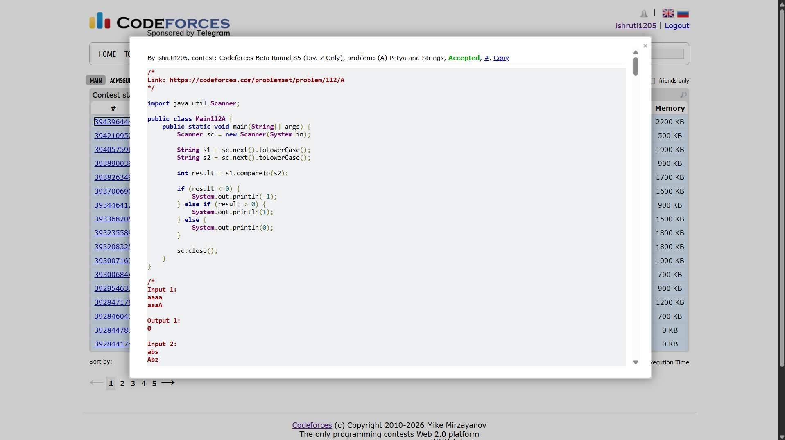

## Date: 13 October 2026 (Day 13)  
**Name:** Shruti  
**Programming Language:** Java 

## Problem
[A. Petya and Strings](https://codeforces.com/problemset/problem/112/A)

## Approach
I convert both strings to lowercase to make the comparison case-insensitive. Then, I use compareTo() to compare them lexicographically. If the first string is smaller, I print -1; if it is greater, I print 1; otherwise, I print 0.

## Code

```java
import java.util.Scanner;

public class Main112A {
    public static void main(String[] args) {
        Scanner sc = new Scanner(System.in);

        String s1 = sc.next().toLowerCase();
        String s2 = sc.next().toLowerCase();

        int result = s1.compareTo(s2);

        if (result < 0) {
            System.out.println(-1);
        } else if (result > 0) {
            System.out.println(1);
        } else {
            System.out.println(0);
        }

        sc.close();
    }
}

/*
Input 1:
aaaa
aaaA

Output 1:
0

Input 2:
abs
Abz

Output 2:
-1

Input 3:
abcdefg
AbCdEfF

Output 3:
1
*/
```

## Accepted Solution Screenshot

